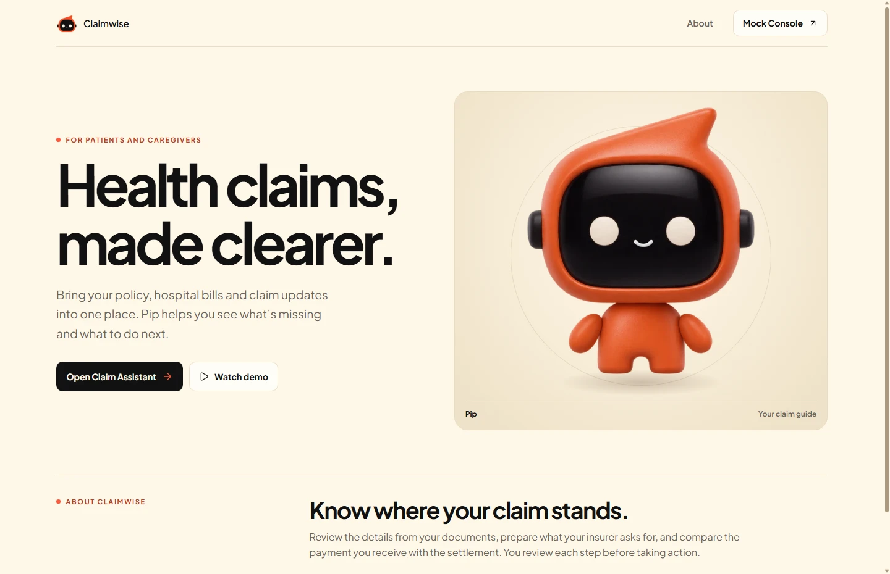
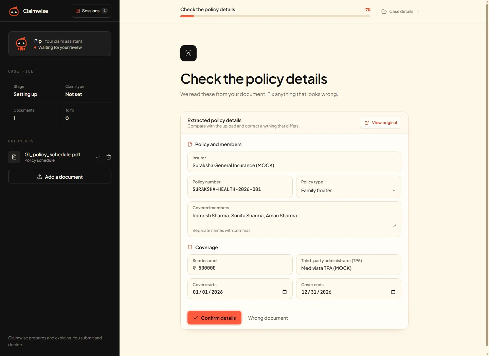

<p align="center">
  
</p>

<h1 align="center">Claimwise</h1>

<p align="center"><strong>A case workspace for health insurance claims, from policy review to payment verification.</strong></p>

<p align="center">
  <a href="submission/claimwise-design.pdf">Assignment PDF</a> ·
  <a href="docs/07-delivery/demo-walkthrough.md">Product walkthrough</a> ·
  <a href="#run-locally">Run locally</a> ·
  <a href="docs/07-delivery/hosting.md">Hosting</a>
</p>



## What Claimwise does

A patient or authorized caregiver opens a case, confirms policy facts, adds evidence, and reviews what needs attention. Claimwise prepares an exportable claim pack, tracks what was submitted, and carries insurer requests, decisions, disputes, and payment evidence forward in the same case. Households can record multiple policies and start a balance claim after the first decision.

**Repository status, 7 November 2026.** The synthetic-data prototype includes the React workspace, the FastAPI and LangGraph agent, mock providers, and scoped provider approval. The hosted configuration uses Vercel and Render, with Neon available for persistent checkpoints. Live provider access and production identity and case authorization are release gates. [Product brief](docs/01-product-brief.md) · [Decisions and open questions](docs/decisions.md)

## Follow a claim with Pip



1. **Start the case.** Open the workspace and upload the synthetic policy schedule from [Run 1](mocks/mock_documents/valid/run1_standard_reimbursement/). Review the extracted facts and confirm who is making the claim.
2. **Review the evidence.** Add the discharge summary and final bill. Resolve any blockers, then build and approve the current pack. Download it for manual submission or use the authorized mock TPA connection.
3. **Follow the outcome.** Use [Mock Console](http://localhost:5173/mocks) to simulate a decision and payment. Bring the bank statement into the case and see how Claimwise distinguishes a reported settlement from a verified credit.

Screenshots were captured from the running application in a fresh workspace using synthetic data. The [walkthrough](docs/07-delivery/demo-walkthrough.md) also covers caregiver authority, multiple policies, a dispute, and a failed or uncertain submission.

## Read the project

| Area | Start here |
| --- | --- |
| Product and research | [Product brief](docs/01-product-brief.md) · [Evidence register](docs/02-research/evidence-register.md) · [Personas](docs/02-research/personas-and-situations.md) · [Alternatives](docs/02-research/alternatives.md) |
| Lifecycle | [Six checkpoints and completion rules](docs/03-lifecycle/lifecycle-map.md) · [Branch matrix](docs/03-lifecycle/branch-matrix.md) |
| Architecture and implementation | [Five graphs and editable sources](docs/04-architecture/README.md) · [Technical reference](docs/05-technical/README.md) · [Function catalogue](docs/05-technical/function-catalogue.md) · [API and tools](docs/05-technical/api-tool-matrix.md) |
| Experience and evidence | [Complete journeys](docs/06-experience/journeys.md) · [UX sketches](docs/06-experience/ux-sketches.md) · [Validation results](docs/07-delivery/validation-plan.md) · [Performance](docs/07-delivery/performance-report.md) |
| Assignment and delivery | [Consolidated PDF](submission/claimwise-design.pdf) · [Traceability](docs/traceability.md) · [Implementation plan](docs/07-delivery/implementation-plan.md) · [Feasibility and rollout](docs/07-delivery/feasibility-and-rollout.md) |

The validation report records **124 of 127 live checks** across 37 specifications on 6 November 2026. Three checks remained open for a live recheck. This is the recorded result for that run. [Validation report](docs/07-delivery/validation-plan.md#failed-checks)

<details>
<summary>Full documentation index</summary>

| Area | Detail |
| --- | --- |
| Research | [Source register](docs/02-research/sources.md) for provenance and access limits |
| Graphs | [G1 Product context](docs/04-architecture/g1-product-context.md), [G2 Lifecycle state](docs/04-architecture/g2-lifecycle-state.md), [G3 Function execution](docs/04-architecture/g3-function-execution.md), [G4 Sequence and recovery](docs/04-architecture/g4-sequence-recovery.md), [G5 Data and context](docs/04-architecture/g5-data-context.md) |
| Diagram files | [Editable sources](docs/diagrams/src/), [SVG exports](docs/diagrams/export/), and [generator](docs/diagrams/make_graphs.py) for G2, G3 and G5 |
| Technical appendix | [Schemas](docs/05-technical/schemas.md) and [example payloads](docs/05-technical/payloads/), [errors](docs/05-technical/error-catalogue.md), [models and retrieval](docs/05-technical/models-and-retrieval.md), [execution and memory](docs/05-technical/execution-and-memory.md), and [permissions and data](docs/05-technical/actions-permissions-and-data.md) |
| Mock systems | [Provider build brief](docs/05-technical/external-systems-and-mocks.md), [mock routes and architecture](docs/05-technical/mock-services-architecture-and-routes.md), and [operator reference](mocks/mock.markdown) |
| Delivery and terms | [Walkthrough document](docs/07-delivery/demo-walkthrough.docx), [frontend deployment](frontend/DEPLOYMENT.md), and [glossary](docs/glossary.md) |

</details>

## Repository map

| Path | Responsibility |
| --- | --- |
| [`frontend/`](frontend/) | React and Vite landing page, Dossier workspace, and Mock Console |
| [`backend/`](backend/) | FastAPI routes, LangGraph turns, evidence checks, and checkpoints |
| [`connectors/`](connectors/) | Case-scoped approval and access to synthetic provider tools |
| [`mocks/`](mocks/) | Mock payer, hospital, bank and grievance services, plus [sample PDFs](mocks/mock_documents/README.md) |
| [`docs/`](docs/) | Product research, architecture, UX, contracts, and delivery evidence |
| [`e2e/`](e2e/) | Journey harness and report generation for the recorded validation |

## Run locally

Use Python 3.13, [uv](https://docs.astral.sh/uv/), and Node.js 22. Run each block in a separate terminal from the repository root.

**Backend**

```powershell
cd backend
if (-not (Test-Path .env)) { Copy-Item .env.example .env }
uv sync
uv run uvicorn app.main:app --host 127.0.0.1 --port 8000
```

Set `GOOGLE_API_KEY` in `backend/.env` for PDF and image reading. Set `DATABASE_URL` for Neon checkpoints, or omit it for an in-memory demo. [Environment and hosting guide](docs/07-delivery/hosting.md)

**Mock providers**

```powershell
cd mocks
uv sync
uv run uvicorn mocks.main:app --host 127.0.0.1 --port 8100
```

**Frontend**

```powershell
cd frontend
npm ci
npm run dev
```

Open [Claimwise](http://localhost:5173/), [the Dossier](http://localhost:5173/app), or [Mock Console](http://localhost:5173/mocks). For connected mock submission, follow the [connector setup](docs/05-technical/provider-connectors.md). For deployment, use the [hosting guide](docs/07-delivery/hosting.md) and [Render Blueprint](render.yaml). Use synthetic records in the demo.
