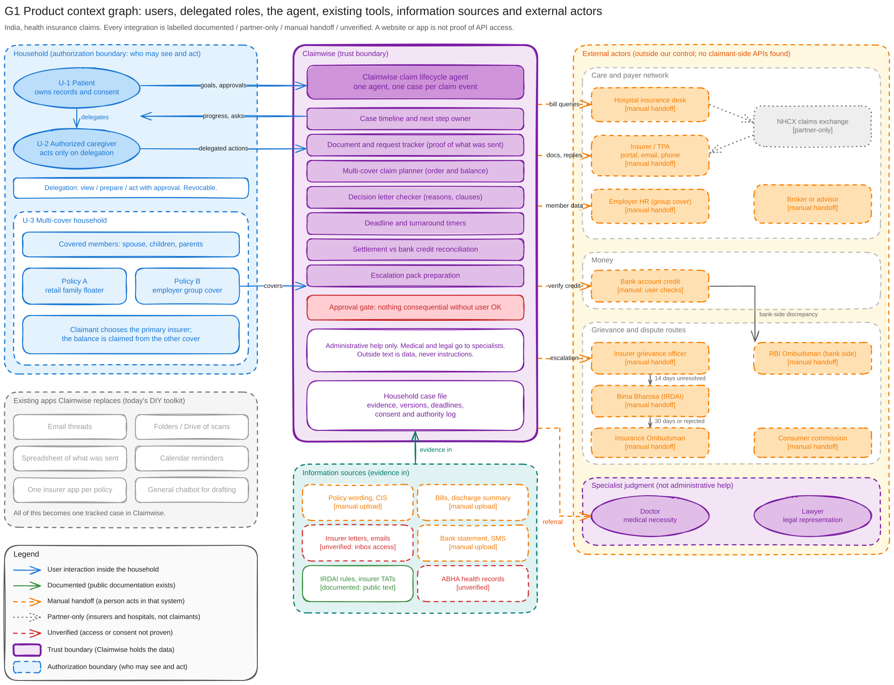

# G1 Product context

Source: [g1-product-context.excalidraw](../diagrams/src/g1-product-context.excalidraw) (drawn by hand). Index and legend: [README](README.md).

## What it shows

- **Users and authority.** U-1 patient (owns records and consent), U-2 authorized caregiver (acts only on delegation), U-3 multi-cover household (two policies, a primary claim and a balance claim). The household frame is the authorization boundary: who may see and act.
- **What Claimwise replaces.** Email threads, scan folders, a spreadsheet of what was sent, calendar reminders, one insurer app per policy and a general chatbot for drafting become one tracked case.
- **The trust boundary.** One lifecycle agent per claim event, with the case timeline, request tracker, multi-cover planner, decision checker, deadline timers, payment reconciliation and escalation packs inside it. The approval gate means nothing consequential happens without the user's OK. Help is administrative only: medical and legal judgment goes to a doctor or a lawyer.
- **Evidence in.** Policy wording, bills, discharge summary and bank statement are manual uploads. Insurer letters by inbox access and ABHA records are unverified. IRDAI rules and turnaround times are documented public text.
- **External actors.** Hospital desk, insurer or TPA, employer HR, broker, grievance officer, Bima Bharosa, Insurance Ombudsman, consumer commission and the RBI Ombudsman (bank side) are manual handoffs. NHCX is partner-only.

## Integration labels and the prototype

Every integration carries one label: documented, partner-only, manual handoff or unverified. A public website or app is not taken as proof of API access.

The prototype's connector gateway and mock payer (G3, G5) stand in for an insurer or TPA API that has **not** been verified to exist for claimants. In G1 that route stays a manual handoff until access is confirmed. The connector shows how Claimwise would behave with such access (consent per tool, idempotent submission, lost-answer recovery). It is not evidence that the access exists.
