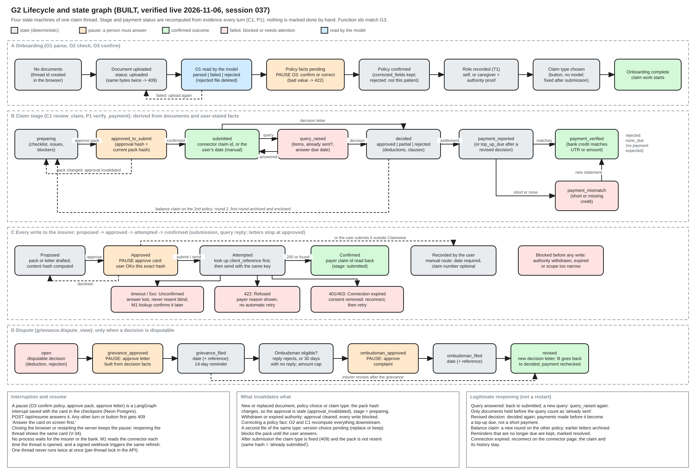

# G2 Lifecycle and state

Source: [g2-lifecycle-and-state.excalidraw](../diagrams/src/g2-lifecycle-and-state.excalidraw), generated by [make_graphs.py](../diagrams/make_graphs.py). Index and legend: [README](README.md).

## Four state machines in one claim thread

| Lane | States | Where it is computed |
|---|---|---|
| A Onboarding | no documents, uploaded, parsed / failed / rejected, policy pending (pause), policy confirmed, role recorded, claim type chosen, complete | O1, O2, O3; `POST /api/claim-type` |
| B Claim stage | preparing, approved_to_submit, submitted, query_raised, decided, payment_reported (or top_up_due), payment_verified, payment_mismatch | C1 `review_claim`, P1 `verify_payment`, recomputed every turn |
| C Writes to the insurer | proposed, approved, attempted, confirmed; unconfirmed, refused, connection expired; recorded by the user (manual route); blocked by authority | X1 handlers, `submission.py` |
| D Dispute | open, grievance_approved, grievance_filed, Ombudsman eligibility, ombudsman_approved, ombudsman_filed, revised | `grievance.dispute_view` |

Stage and payment status are never stored as a user decision. They are derived from documents and user-stated facts every turn, so they cannot drift from the evidence.

## Proposed, approved, attempted, confirmed

1. **Proposed:** X1 or T1 builds the pack or letter and hashes its content.
2. **Approved:** a pause shows the exact content. Approval stores the hash, and any change to the content makes it stale.
3. **Attempted:** for a submission, the payer is asked for the client reference first, then sent the pack with the same key as the idempotency key.
4. **Confirmed:** the payer's claim id is read back, or the user records the date for the manual route.

Grievance and Ombudsman letters stop at approved: the user files them, then records the date and reference.

## Interruption and resume

A pause is a LangGraph interrupt saved with its card in the checkpoint. Any other request on that thread gets 409 until the card is answered. Closing the browser or restarting the server keeps the pause (V-34). No process waits for an insurer: M1 reads the claim when the thread opens or a signed webhook arrives.

## Invalidation and reopening

Both are listed in the panels at the foot of the graph. In short: any change to the pack makes its approval stale, and a withdrawn authority clears it. A revised decision reopens only the decision and payment check, and a balance claim starts a new round on the other policy.

---

Previous: [G1 Product context](g1-product-context.md) | [Index](../../README.md) | Next: [G3 Function execution (agent graph v0.8)](g3-function-execution.md)
