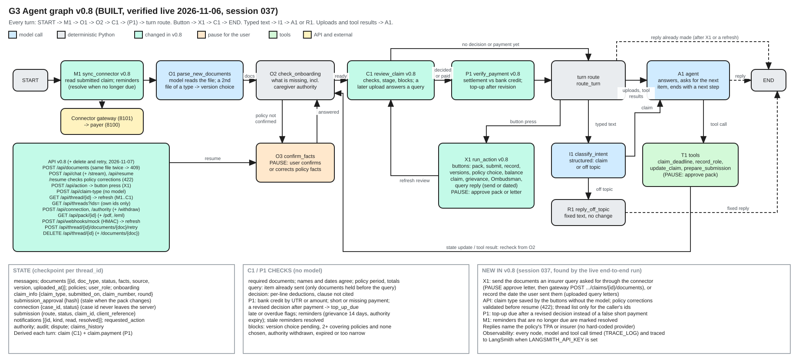

# G3 Function execution (agent graph v0.8)



Source: [g3-agent-graph.excalidraw](../diagrams/src/g3-agent-graph.excalidraw), generated by [make_graphs.py](../diagrams/make_graphs.py). Code: `backend/app/agent/graph.py`. Index, legend and function ids: [README](README.md).

## One turn

```
START -> M1 sync_connector -> O1 parse_new_documents -> O2 check_onboarding
O2 -> O3 confirm_facts (pause) -> O2          when a policy is not yet confirmed
O2 -> C1 review_claim -> P1 verify_payment    once the insurer decided or says it paid
C1 or P1 -> turn route:
   button pressed   -> X1 run_action -> C1 -> END
   typed text       -> I1 classify_intent -> A1 agent | R1 reply_off_topic -> END
   uploads, results -> A1 agent
A1 -> T1 tools -> O2 (recheck)   or   A1 -> END
```

| Edge | Data it carries |
|---|---|
| M1 to O1 | Connector records added to `documents` (source connector), submission status, reminders |
| O1 to O2 | Parsed documents and pending policy facts |
| O2 to O3 | The policy card (pause) |
| O3 to O2 | The confirmed or corrected facts |
| O2 to C1 | Onboarding complete or missing items |
| C1 to P1 | Decision and settlement facts |
| Turn route to X1 | `requested_action` {id, data} |
| X1 to C1 | The state update from the button (approval, submission, dispute, versions) |
| A1 to T1 | Tool calls; T1 to O2: tool results and state updates |

## Pauses, retries and failure exits

- Pauses: O3 (confirm policy), approve pack (X1 or T1 `prepare_submission`), approve letter (grievance, Ombudsman, query reply).
- Retries: chat and classification calls fall back from Gemini to Groq (60-second timeout, two retries each); document reading is Gemini only. Writes to the insurer look up the client reference before sending and never resend blind.
- Failure exits: a failed parse marks the document failed. Connector 401/403 marks the connection expired, a 422 refusal is shown, and an unclear error leaves the submission unconfirmed. A blocked authority stops every write. An unknown or stale button gets 409 at the API.
- Parallel steps and joins: none inside a turn. Background timers: none. Dated reminders are checked on each run.

## Changed in v0.8 (session 037)

Each change was found by the live end-to-end run and is covered by a backend test:

- X1 answers an insurer query. It sends the requested documents through the connector after approval, or records the date the user sent them.
- `POST /api/claim-type` saves the claim type without the model.
- `/api/resume` validates policy corrections (422).
- `/api/threads` returns only the caller's ids.
- P1 reports a top-up due after a revised decision instead of a false short payment.
- M1 marks reminders that are no longer due as resolved.
- C1 counts only documents held before a query as "already sent".
- Every node, model call and tool call is timed (`TRACE_LOG`), and traced to LangSmith when a key is set.

## API added after v0.8 (2026-11-07, APP-043)

These routes act on stored state, not on the graph's node order, so the graph itself is unchanged:

- `POST /api/thread/{id}/documents/{doc}/retry` reads a failed document again (O1).
- `DELETE /api/thread/{id}/documents/{doc}` purges one document from the current and earlier checkpoints and removes its file; onboarding is rechecked if a policy is still pending.
- `DELETE /api/thread/{id}` deletes the whole session: checkpoints, files and the webhook lookup.

---

Previous: [G2 Lifecycle and state](g2-lifecycle-state.md) | [Index](../../README.md) | Next: [G4 Sequence and recovery](g4-sequence-recovery.md)
