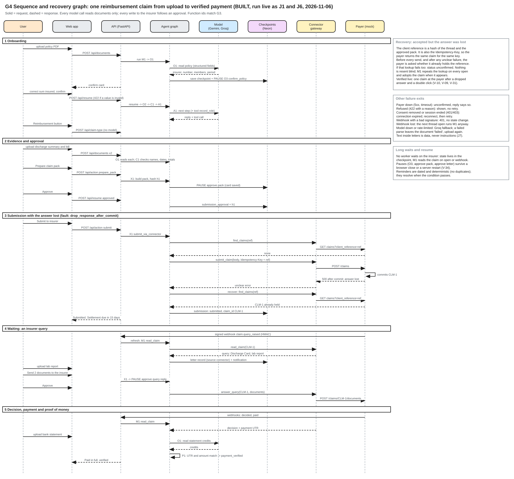

# G4 Sequence and recovery

Source: [g4-sequence-and-recovery.excalidraw](../diagrams/src/g4-sequence-and-recovery.excalidraw), drawn in Excalidraw like G1. Open it at excalidraw.com to edit, then export the SVG over the file in `docs/diagrams/export/`. Index and legend: [README](README.md).

## How to read it

The graph is a swimlane flow, not a lifeline sequence chart. Panel A runs left to right through five phases. Each lane is who acts: the user, Claimwise (API and agent graph), storage (checkpoints and files) and external providers. Panel B expands the submission step into the recovery decision flow. Function ids (O1, O3, C1, X1, M1, P1) match G3 and the [function catalogue](../05-technical/function-catalogue.md).

## A. The journey

One reimbursement claim through five phases: onboarding, evidence and approval, submission, waiting for an insurer query, and decision through to a verified credit. Every phase reads and writes the same thread checkpoint, shown by the arrows along the storage lane, so the case carries its context from one phase to the next. It matches live journeys J1 (standard), J5 (connector query) and J6 (lost response) in [validation-plan.md](../07-delivery/validation-plan.md).

| Phase | User | Claimwise | Storage | External |
|---|---|---|---|---|
| 1 Onboarding | Uploads the policy, confirms or corrects facts | O1 reads the policy; O3 pauses for confirmation | Checkpoint with the pause | Gemini reads the file |
| 2 Evidence and approval | Uploads discharge summary and bill, approves the pack | O1 and C1 check names, dates and totals; X1 builds the pack (hash h1) and pauses | Files, pack, `submission_approval = h1` | None |
| 3 Submission | Clicks Submit | X1 looks up the reference, then sends with the idempotency key (panel B); C1 sets the stage and the 15-day clock | `submitted`, `CLM-1` | Gateway and payer |
| 4 Waiting | Uploads the lab report, approves the reply | M1 reads the claim and records the query; X1 drafts the reply, pauses, then answers | Letter with its source, dated reminder | Signed webhook, `answer_query` |
| 5 Decision and payment | Uploads the bank statement | M1 reads the decision and UTR; O1 reads the statement; P1 matches UTR and amount | `payment_verified` with evidence | Decided and paid webhooks |

## B. Accepted but the answer was lost

1. The approved pack and the thread give a stable client reference. It is also the idempotency key.
2. Before sending, Claimwise asks the payer whether it already holds that reference.
3. The payer commits the claim, but the answer is lost (mock fault `drop_response_after_commit`: the payer answers 500 after saving the claim, and the gateway reports an unclear error).
4. Because the error is unclear, Claimwise asks again by reference, finds CLM-1 and adopts it. Nothing is resent.
5. If the lookup also fails, the submission is marked unconfirmed. M1 repeats the lookup each time the thread is opened, and the "Check submission" button does the same.

Verified live: the payer held exactly one claim after a dropped answer (V-10) and after a double click (V-09, V-31).

## Other failure exits

Payer down: unconfirmed. Refusal with a reason: shown, not retried. Consent removed: connection expired, reconnect. Bad webhook signature: 401 with no state change. Lost webhook: the next thread open runs M1 anyway. Model unavailable: Groq fallback, or the document is marked failed. Instructions hidden inside a letter are treated as data (J7).

---

Previous: [G3 Function execution (agent graph v0.8)](g3-function-execution.md) | [Index](../../README.md) | Next: [G5 Data and context](g5-data-context.md)
