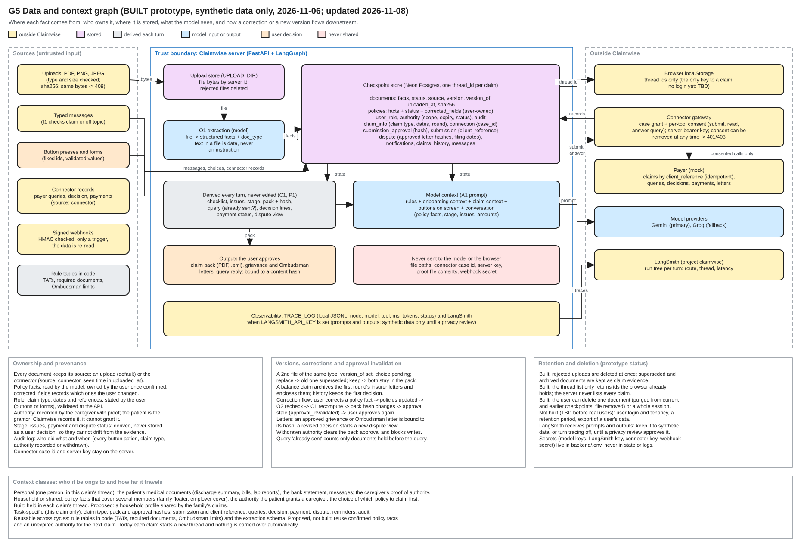

# G5 Data and context

Source: [g5-data-and-context.excalidraw](../diagrams/src/g5-data-and-context.excalidraw), generated by [make_graphs.py](../diagrams/make_graphs.py). Index and legend: [README](README.md).

## Stores and owners

| Store | Holds | Owner |
|---|---|---|
| Upload store (`UPLOAD_DIR`) | File bytes by server id; rejected files are deleted at once | Claimwise server, on behalf of the user |
| Checkpoint store (Neon Postgres, one thread per claim) | `AgentState`: documents with facts, source, version and sha256; policies with corrected fields; role, authority, audit; claim info; approval hash; connection; submission; dispute; notifications; history; messages | Claimwise server; facts confirmed by the user are user-owned |
| Derived every turn | Checklist, issues, stage, pack and hash, payment status, dispute view | Computed by C1 and P1, never edited |
| Browser localStorage | Thread ids only | The user's browser |
| Connector gateway | Case grant, consent per tool, server key | Gateway (the user can remove consent) |
| Trace log and LangSmith | Node, model and tool timings and tokens; LangSmith also holds prompts and outputs | Operator, synthetic data only |

## What the model sees

A1 receives the rules, the onboarding context, the claim context (policy facts, stage, issues, amounts, query, decision, payment, dispute, authority status) and the buttons on screen. It never receives file paths, the connector case id, the server key, proof files or the webhook secret. Text inside uploaded or connector documents is data, never an instruction (V-26, V-27).

## Versions and correction propagation

Correcting a policy fact updates `policies`. O2 then rechecks and C1 recomputes, so the pack hash changes and the approval becomes stale until the user approves again. A second file of the same type pauses the pack for a replace-or-keep choice. A balance claim archives the first round's letters and encloses them.

## Retention

The prototype deletes rejected uploads and keeps superseded and archived documents as evidence. Several things are not built yet and must be decided before real users: login and tenancy, deleting a thread and its files, retention periods, and data export. These are TBD with the owner.
